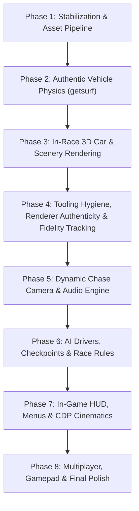

# Ignition (1997) Source Port Master Implementation Roadmap

See the [playable acceptance roadmap](windows_playable_roadmap.md) for remaining
whole-game milestones and explicit toolchain/fidelity limits.

## Sprite submission adapter reconstruction (2026-10-14)

[Submission evidence](ghidra/windows_sprite_submit.md), RVA `0x57370`, reconstructs
`Gfx_SubmitSpriteRequest` in `decomp/src/renderer.c`. Resolves the former adapter
analysis blocker by connecting descriptor lookup (`0x612E0`) and packet preparation
to `Gfx_RasterizeSpritePacket` (`0x65BB5`) via the documented `DEV-007` typed C interface.
264 differential trials pass (168 exhaustive lookup permutations with post-lookup perturbation
hooks, 32 transformed sprite delegations, and 64 valid full-pipeline blits with byte-for-byte
framebuffer pixel matching).
Next in sprite pipeline: `0x57250` (`Gfx_SpriteDrawListNative`), then remaining triangle rasterizers
and native startup/menus/input/audio/race validation.

## Sprite packet integration review (2026-10-14)

[Packet evidence](ghidra/windows_sprite_packet.md), RVA `0x65BB5`, repairs the
pending scalar draft using authenticated source-offset bits, signed dimensions,
clipping exits and descending pipelined pixel writes in production C89.
Focused 352 comparisons pass, including eight real faults and ordered reads,
stores and overlapping source/frame buffers. Full workflow and commit pending.
Transformed delegation remains an explicit test boundary; next close the complete
packet-to-triangle path and native sprite frames, then native startup/menu/input/
audio/races. Original compiler identity and playable game remain unresolved.
Astra owns shared harness/SQLite/exports integration by user-authorized coordination;
Sol released mutation ownership. Preserve unrelated work and original assets.

## Complete ordinary/clipped triangle parents (2026-10-14)

[Parent evidence](ghidra/windows_triangle_parents.md), RVAs0x5CA50/0x5D170,
closes real renderer helpers and borrowed verified workspace storage in C89.
Focused1,139 comparisons/530followups/9faults pass; all earlier312ordinary and
60clipped fixtures retained. Native48paired parent calls match complete frame,
edge and shared-state bytes using real configure/clip helpers. Loader/NX and
caller-owned workspace boundaries remain explicit. Full122renewal/audit/exports
pass at snapshot `c0ae71a8e923`, with51scopednative records and48guardtests.
LF/index gates/hooks follow.
Next realsprite/workspace/startup integration and nativegame menus/input/audio/
races; original compiler remains unresolved and playablegoal stays active.

## Direct viewport and state routines (2026-10-14)

[Viewport evidence](ghidra/windows_viewport_setters.md), six RVAs0x56F40/50/60,
0x57020,0x57110/70, closes real sprite configuration and triangle viewport writes.
Production is directly compiled renderer C89; shared harness links real module
and removes duplicate viewport backing. Focused2,448 comparisons pass, including
14pointer faults and1,792followups; strict shared call-identity audit passes.
Paired native viewport448calls compare records/all16state objects.
Full120 renewal/audit/exports pass at snapshot `d76b20a59751`, with49 scoped
native records and48 guardtests. LF/index gates/hooks follow. Gradient commit `a1b6590` passed full114 renewal at
snapshot `168c99a0c897`; older pending text is corrected. Continue nativeviewport,
wholetriangle/directworkspace/sprite integration; playablegame/toolchain stay open.

## Triangle gradients and correction tables (2026-10-13)

[Gradient evidence](ghidra/windows_triangle_gradients.md), RVA0x24EA80,
reconstructs complete runtime-free C89 gradients and correction table output.
Verified48byte vertex and32byte scratch backings close real edge dependencies.
Focused2,260 differential calls pass, with516 actualdividefaults and872followups.
Full renewal/snapshot/gates pending; no nativegradient/game claim. Continue
wholetriangle parents, realviewport setters, directworkspace migration and
nativeframes. Original toolchain and playablegame validation remain open.

## Ordinary edge wrappers (2026-10-13)

[Ordinary edge evidence](ghidra/windows_ordinary_edges.md), RVAs0x24EC00/0x24EC40,
closes actual initializer/emitter dependencies in readable production C89.
Focused1,282 differential calls pass, with422 actual faults,568 packet/output
aliases and430 persistent followups. Full113 renewal/audit/exports pass at
snapshot `3e7c31572473`; all48 guard tests pass. LF/index gates/hooks follow.
Next reconstruct authenticated gradients, then complete triangle/sprite/native
frames. Native game validation and original toolchain remain unresolved.

## Clipped edge wrappers (2026-10-13)

[Wrapper evidence](ghidra/windows_edge_wrappers.md), RVAs 0x24EFA0/0x24F0C0,
closes real splitter/initializer/clamp/emitter dependencies in direct C89 renderer.
JE-only zero checks preserve negative headers and mandatory first records.
Focused 1,284 differential calls include 420 faults, 568 packet/output aliases
and 432 persistent followups. Full111 renewal/audit/exports pass at snapshot
`bdf9392387ee`; all48 guard tests pass. LF/index gates/hooks follow. No native
wrapper/game proof is claimed. Continue ordinary wrappers, gradients and complete
triangle/sprite/native frames; original toolchain and playable game remain open.

## Full edge splitter and viewport backing (2026-10-13)

[Splitter evidence](ghidra/windows_edge_splitter.md), RVA0x24F270, reconstructs
complete top/bottom/right clipping and split effects in direct C89 renderer.
Verified36byte viewport and20byte saved-end state replace isolated right backing.
Runtime-free unsigned division/high products retain authentic faults, ordered
reloads and the live second-right/special-quotient path. Focused858 differential
calls, 177 faults, 340 aliases and340 followups pass; clamp1028 stillpasses.
Full109 renewal/audit/exports pass at snapshot `721d387ecc1d`, with43existing
scoped native records; LF/index gates/hooks follow. No new native splitter/parent proof. Nextclose actual clipped-edge wrapper dependencies, then
gradients/wholetriangle/sprite/nativeframes. Toolchain and playable startup/menu/
input/audio/representative races remainunresolved; persistentgoal staysactive.

## Runtime-free edge increments and first samples (2026-10-13)

[Step evidence](ghidra/windows_edge_steps.md), RVA 0x24F4D0, reconstructs
the complete initializer and verified32byte shared state in direct C89 renderer.
Paired-word arithmetic removes missing wide-runtime callees while preserving
original peculiar numerators, dy65/dy3 adjustments and actual IDIV faults.
Focused1,314 differential calls, 740 faults, 605 aliases and 287 followups pass;
416 emitter comparisons and existing span/slope native checks pass separately.
Full108 renewal/audit/exports pass at snapshot `0bfc0061763a`, with 43 existing
scoped native records; LF/index gates/hooks follow. No new native initializer/
parent proof is claimed. Continue actual clipped-edge splitter/wrappers
and gradients/triangle/sprite integration; original toolchain and playable game
startup/menu/render/input/audio/race validation remain open.

## Right-endpoint edge clamp (2026-10-13)

[Clamp evidence](ghidra/windows_edge_clamp.md), RVA 0x24F489, reconstructs
the real mutable-packet clamp in direct C89 renderer.c. DEV-007 adapts ESI
to an explicit pointer; unsigned halfword products retain signed product bits
without 64bit types/runtime helpers. Exact initial guard access order and live
V-gradient/right reloads are preserved. Focused 1,028 differential calls,
512 followups, 40 diagnostic mutations and four faults pass. Full107 renewal/
audit/exports pass at snapshot `4d01660de828`, with 43 existing scoped native
records; LF/index gates/hooks follow. No new native clamp/parent proof is claimed. Continue real edge setup/gradient/clipping dependencies and
resolve wide division lowering; original toolchain/playable game remain open.

## Native cdecl triangle-edge slope (2026-10-13)

[Slope evidence](ghidra/windows_triangle_slope.md), RVA 0x5D7A0, reconstructs
the real four-word cdecl helper in the direct C89 renderer. Wrapped numerator/
denominator arithmetic, signed quotient and equal-Y sentinels remain authentic.
Focused 1,025 differential cases include a real original/C IDIV exception;
84 paired native normal calls pass. Full106 renewal/audit/exports pass at
snapshot `ba3d21e1a6d1`, with 43 scoped native records; LF/index gates/hooks follow.
Native SEH/unwinding and complete game/triangle
integration are unverified. Continue real edge setup, gradients and clipping
after the separate commit; original toolchain and playable-game validation stay open.
Current wide-division lowering lacks verified 32bit runtime helpers; the real
right-endpoint clamp is unblocked (signed product/shift links import-free).
See slope evidence for the concrete dependency diagnostics.

## Raw and corrected edge record emitters (2026-10-13)

[Emitter evidence](ghidra/windows_edge_emitters.md), RVAs 0x24F1E0/0x24F220,
reconstructs complete record generators in the direct C89 renderer module.
DEV-007 explicitly carries original register inputs/outputs in a typed cursor.
Raw low16 count wrapping and corrected signed32 behavior, live increment/table
reads and mandatory first records are preserved. Focused 408 differential calls,
192 followups, 64 aliases, ten faults and 298,822 records pass. Existing span
differential/native coverage passes separately; new native emitter/parent
execution is unverified. Full105 renewal/audit/exports pass at snapshot
`cb5157ea80c4`, with 42 existing scoped native records; LF/index gates/hooks follow.
Next pursue real cdecl slope and edge setup/gradient/clipping
dependencies; complete native playable game and original toolchain remain open.

## Texture span dependency closure (2026-10-13)

[Span evidence](ghidra/windows_texture_spans.md) reconstructs setup and both
compositing paths plus their wrappers in directly compiled renderer.c, RVAs
0x5C990/0x67F1C/0x5C9B0/0x67F42/0x5C9D0/0x67F97. DEV-007 documents
the explicit C interface replacing internal register inputs, with real complete
leaves and no assembly shim. Focused 896 differential calls, 74 faults and
64 paired native cases comparing 12,582,912 buffer bytes pass. Full 103-routine
renewal, audit and exports pass at snapshot `b30e9897223a`, with 42 scoped native
records. LF/index gates and tracked hooks follow. Continue
real edge/gradient/triangle dependencies after that commit; original viewport/
texture initialization and complete native playable game validation stay open.

## Surface constant bodies and configuration entry (2026-10-13)

[Evidence](ghidra/windows_surface_constants.md), RVAs 0x5C150/0x5C520/0x56C60,
closes the last surface-only fixture boundaries with directly compiled C89 bodies
and the real installed forwarding entry. Focused 2,049 differential calls and
72 paired native calls pass; return 2 is preserved without invented status meaning.
Full 97-routine renewal, audit and exports pass at snapshot `8dbcc3c631d3`,
with 36 scoped native records. LF/index gates and tracked hooks follow. Next close
the verified texture-span setup/wrapper/leaf graph in a direct renderer module,
with explicit internal C interfaces and documented register-ABI adaptation.
Complete native game startup/menu/render/input/audio/races and original toolchain
remain unresolved; the persistent playable-game goal stays active.

## Native byte-copy body and forwarding entry (2026-10-13)

[Byte-copy evidence](ghidra/windows_surface_copy.md), RVAs0x5C1D0/0x56B70,
uses real Lock/Unlock and verified byte units in full C89 surface.c. Original
instructions/helpers and24 native copies precede implementation. Focused1,334
comparisons,54 paired SDK copies and884,736 readback bytes pass, including forward
overlap, all four modes and original invalid-size prefixes. Full renewal, fidelity
audit and exports pass at snapshot `0d2549f92439`, with94 fresh compilation/emulation
and33 scoped native records. Strict symbolic link dependencies are extended without
an instruction-equality claim. LF/index, staged gates and hooks follow. Continue unblocked rendering/startup dependencies; native
playable startup/menu/input/audio/races and original toolchain remain unresolved.

## Native BltFast body and forwarding entry (2026-10-12)

[Blit evidence](ghidra/windows_surface_blit.md), RVAs0x5C160/0x56B30, now uses
real surface records and SDK BltFast in the directly compiled surface module.
Original FPO/instructions,9,990 original oracle cases and12 actual SDK copies
precede implementation. Focused20,002 comparisons and24 paired native copies,
98,304 destination pixels and96 inactive guards pass. Destination argument7=x,
argument8=y is independently observed. Full renewal, fidelity audit and exports
pass at snapshot `a62df57f1794`, with92 fresh compilation/emulation and31 scoped
native records. LF/index, staged gates and tracked hooks follow.
Continue real pixel copying and startup/rendering dependencies; production frames,
playable menu/input/audio/races and original toolchain remain unresolved.

## Direct surface module migration (2026-10-12)

[Migration evidence](ghidra/windows_surface_module.md) carries twelve unchanged
verified routines and their DirectDraw backing into full C89 `surface.c` /
`surface.h`. Platform backing and graphics entry wrappers retain their owners.
Local PE routine hashes, whole-module build/link and thirteen freshness tests pass.
Full renewal, fidelity audit and exports pass at snapshot `d17f20ac4617` with90 fresh
compilation/emulation and29 scoped native records. Native foreground preparation
now precedes authentic Acquire; bounded marker-specific prerequisite retries retain
all attempts and never retry behavioral failures. Final polling/timed probes each
passed first attempt; prior failed renewals remain documented. LF/index, staged
gates and tracked hooks are required before commit. Continue authentic
BltFast and pixel-copy behavior immediately afterward. Original toolchain and
playable startup/menu/audio/race validation remain open.

## Palette oracle mapped-source correction (2026-10-12)

The [palette verifier](ghidra/windows_surface_palette.md) now uses a mapped RGB
buffer and asserts72 normal copies and eight post-copy interface changes in both
images. Focused1,424 comparisons pass; the old0x5000 buffer lay outside the0x4000
arena, so its normal/mutation scope was overstated. Actual bank aliases and24 native
SDK updates were valid. Production bodies remain unchanged. Full renewal, fidelity audit and exports pass
at snapshot `c7c1048073f9` for 90 reconstructions and 29 scoped native records.
LF/index checks, staged gates and hooks follow. Continue directly compiled renderer subsystem work;
original toolchain and complete native game/menu/audio/race validation remain open.

## Native palette body and installed entry (2026-10-12)

[Palette evidence](ghidra/windows_surface_palette.md), RVAs 0x5C6D0/0x56C40,
now uses real SDK SetEntries, a separately verified third entry bank and retained
flag bytes. Focused 1,376 comparisons, 24 actual paired SDK updates and 48 null guards
pass. The shared native host also preserves eight paired fullscreen presentation
flips; RVAs 0x5C4B0/0x56C90 receive renewed evidence. Full renewal, fidelity audit and exports pass for all 90 reconstructions, with
29 scoped native records, at snapshot `166b80e3a1ac`. Staged gates/hooks follow.
Next reconstruct real pixel blitting/copying/rendering and startup/window-message
dependencies. Palette object updates and test-owned frame fills do not complete
production rendering; playable menus/audio/races and original toolchain remain open.

## Native presentation body and installed entry (2026-10-12)

[Presentation evidence](ghidra/windows_surface_present.md), RVAs 0x5C4B0/0x56C90,
now uses real SDK GetCaps/Flip and actual installation. Focused 3,860 differential
comparisons, 72 native windowed rejection calls and eight actual paired fullscreen
flips with 2,457,600 primary-pixel checks pass. Preserve the ignored
GetCaps result, exact busy retry and live target/primary reloads. One mode/one
backbuffer uses test-owned SDK fills and checked display restoration; full production
rendering remains unverified. Full renewal, fidelity audit and exports pass for all 88 reconstructions, with
27 scoped native records, at snapshot `e607f844ec6e`. Staged gates/hooks follow. Next authenticate palette and
real rendering/startup/window-message dependencies. Original compiler and playable
menus/audio/races remain incomplete.

## Native surface Clear and installed-table entry (2026-10-12)

[Clear evidence](ghidra/windows_surface_clear.md), RVAs 0x5C3D0/0x56BB0,
now uses real production Lock/Unlock and authentic installation. Focused 2,996
comparisons and 16 actual paired bounded offscreen clears pass. Preserve the
observed DWORD-scaled SDK byte-pitch bug and original mode restoration. Full
renewal, fidelity audit and exports pass for all 86 reconstructions, with 25
scoped native records, at snapshot `21647812d76d`. Staged gates/hooks follow. Next reconstruct authentic presentation,
palette and real rendering/startup dependencies. Full-frame/native fault behavior,
original compiler and playable menus/audio/races remain unresolved.

## Native surface access fields and SDK calls (2026-10-12)

[Two real access routines](ghidra/windows_surface_access.md) pass 1,920 differential
comparisons and native primary/backbuffer Lock/Unlock mode transitions. Five opaque
record words now have verified lock/mode/read/write/pitch names; initialization
0x56A40 regression is included. Full renewal, audit and exports pass for all 84 reconstructions at snapshot
`af3bc931c777`. Staged gates and tracked hooks follow. Preserve the
original field-address Unlock argument and undefined failed-descriptor transients.
Next investigate authentic Clear/presentation/palette behavior with real access
dependencies; do not silently correct DWORD-scaled pitch or invent native flips.
Native complete rendering/startup/menus/audio/races and original toolchain remain open.

## Timed input subsystem (2026-10-12)

[Six real input routines](ghidra/windows_input_timed.md) pass 6,448 differential
comparisons and native asynchronous timer polling with state consumption, shutdown
entry and reinit. The opaque keyboard arrays now have verified press-edge/latch
names; initialization/polling regressions are included. Full workflow, audit and exports pass for all 82 reconstructions at
snapshot `28f372557d7a`. Staged gates and tracked hooks follow. Native teardown uses test-owned timer quiescence; arbitrary reentry/
concurrent teardown and no-push timing callers remain explicit limitations.
Next advance native graphics presentation/rendering and real startup/WndProc.
Queued-character helpers and original toolchain remain unresolved. Full playable
game startup, menus, rendering, input, audio and representative races remain required.

## Buffered keyboard dependency chain (2026-10-12)

[Native polling](ghidra/windows_input_polling.md) implements real DirectInput data
access with key callback, character ring and five-word timer callback.1,166 focused
comparisons and paired native scan30 press/release paths pass; full renewal, audit and exports pass for all 76 reconstructions at snapshot
`ca2851cbbf7e`. Staged gates and tracked hooks follow. Initialization backing at0x55AC0 is part of the regression scope.
Next authenticate and reconstruct actual held/edge/repeat/queue consumers, timed
setup and reinitialization, followed by WndProc/WinMain dependencies. Preserve the
authentic missing timing arguments. Asynchronous timing, original compiler/linker,
native full startup/menu/render/audio/races and playable rebuilt game remain open.

## Native input dependencies (2026-10-10)

[Input lifecycle](ghidra/windows_input_lifecycle.md) reconstructs real keyboard
setup and teardown RVAs0x55AC0/0x55E20, with 272 differential cases and actual
paired native driver/timer lifecycles. Preserve the verified repeat timing caller
anomaly. Next recover polling RVA0x55EF0 through its real character-ring and key
event consumers, then real window/startup/game paths. Full workflow renewal,
audit and exports pass at snapshot `924c053b83b0` for all 72 reconstructions.
Native game input/events, menus/render/audio/races,
timed polling/reentry and original compiler/link layout remain unverified.

## Native graphics entry points (2026-10-10)

[Graphics entry points](ghidra/windows_graphics_entry.md) now reconstruct Open,
Rebuild and Shutdown plus authentic sprite Open/Shutdown leaves. 525 differential
comparisons include 47 faults and 140 follow-ups; four paired native scenarios
execute real surface installation and lifecycle bodies with the original WndProc
reference boundary. Sprite lifecycle slots use real bodies, while allocating sprite
installation stays outside this native scope. The full workflow renews all 70
reconstructions and audit/exports pass at snapshot `5ed35d7ce096`. Next recover
native input shutdown, then independently resolve input-init repeat timing
arguments and real WinMain/WndProc/game dependencies. The playable standard
Windows game and native menus/render/input/audio/race validation remain incomplete.

## Native surface rebuild (2026-10-10)

[Surface rebuild](ghidra/windows_surface_rebuild.md), RVA0x5BD70, now implements
actual SDK release/create/palette behavior with real initialization/restoration.
Historical Close is renamed Rebuild. 360 comparisons include164 follow-ups,
43 faults and22 executed mutations. Three paired native windowed scenarios execute
two rebuilds plus production shutdown, proving record clearing while primary/type1
interfaces remain alive outside records. Both palette buffers are tracked separately.
Original WndProc is a reference boundary; native full game/startup/fullscreen/palette
and original compiler/link configuration remain open. Next recover sprite shutdown
and real graphics/WinMain dependencies. The focused DLL/host are not the rebuilt game.

## Native graphics resource shutdown (2026-10-10)

[Resource shutdown](ghidra/windows_surface_shutdown.md), RVA 0x5C060, now uses
actual SDK Release methods with verified mode-conditioned bank ordering. The
historical Reset name is corrected to Shutdown. 384 differential comparisons
include 173 follow-ups, 51 faults, 18 executed mutations and shared interfaces.
Four paired native constructor/shutdown scenarios use real interfaces, including
type2 bank boundaries, and preserve stale clipper/markers/geometry/HWND behavior.
The original WndProc remains a reference boundary; native full game/startup,
fullscreen/palette branches and original compiler/link layout remain open.
Next reconstruct surface rebuild RVA0x5BD70 and its caller dependencies.

## Native surface constructor (2026-10-10)

[Surface constructor](ghidra/windows_surface_open.md), RVA 0x5B740, has real C89
Win32/GDI/DirectDraw behavior and real initialization/restoration dependencies.
242 differential comparisons include 108 persistent follow-ups, four interface
faults and 37 executed mutation calls. Four paired native scenarios pass actual
API/COM execution: missing class and windowed 0/1/4 backbuffers, using authenticated
original WndProc as a reference boundary. This does not certify a rebuilt WndProc
or native game startup. Width/height/depth fields and real stdcall import libraries
are independently verified. Native fullscreen/lost-device, complete game behavior
and original compiler/link layout remain open. Next reconstruct actual display
resource shutdown/rebuild and then input/WinMain dependencies. The focused DLL
and probe remain validation artifacts.

This document defines the complete engineering roadmap and milestone plan for **Racing Dynamite**, the clean-room reverse engineering and modern C11/SDL2 source port of **Ignition** (1997, Unique Development Studios / Virgin Interactive), targeting standard Windows `IGN_WIN.EXE`, with `MAINDOS.EXE` retained as a secondary DOS reference.

---

## Surface lifecycle dependencies (2026-10-09)

[Surface lifecycle](ghidra/windows_surface_lifecycle.md) now reconstructs record
initialization RVA 0x56A40, configure RVA 0x5B730 and restoration RVA 0x5C730.
The 48-byte record layout and real SDK IsLost/Restore calls are verified; eight
record words remain opaque. Focused contracts pass 48/48/1,160 comparisons,
including 108 object/vtable faults, 106 callback mutation calls and persistent
initialization/restoration. COM replies are modeled in emulation. Native
DirectDraw/window/game parity, instruction equality and original compiler/link
layout remain open. Next recover complete Open/Close/Reset and authentic
WinMain/WndProc dependencies. The focused DLL is not a playable game.

## Persistent Windows execution roadmap (2026-10-09)

The persistent goal is a playable rebuilt standard Windows game with documented
native startup, menus, rendering, input, audio and representative races. Continue
across independently authenticated, validated and separately committed features.
The clean starting checkout was 169c493; local target fingerprint and live Ghidra
reachability pass. Active program selection is a user-provided assumption.

Current dependency path: pixel leaf 0x612A0 and storage 0x61530 are reconstructed;
byte/aligned free 0x5F8B0/0x61A60 add real release dependencies. Packing release 0x618B0 now has production C89 and 1,267 focused comparisons
with real free dependencies. String-copy 0x60480 now has production C89 and 941 focused comparisons, with
a documented Unicorn cross-page store limitation. Pointer-table growth
0x5F560 now has production C89 and 363 focused comparisons, with six distinct
controls verified statically. Complete ImageOp 0x61360 now has production C89
and 361 focused comparisons with coherent control and real helpers. Its shared
control backing also renews default initialization 0x611D0 and descriptor copying
0x612E0 coverage. HandleOp 0x5C830 now has production C89 and 150 focused comparisons with
real ImageOp descendants, persistent packed lifecycle and verified static
freelist/scratch/pool/cursor bindings. Primitive startup
0x5E610 now executes its real initialization dependencies. Rendering register-ABI blockers remain
in windows_triangle.md; pursue unblocked resource/platform work while resolving
a pure-C integration strategy. Native startup/presentation baseline and executable
linking, original toolchain evidence, input/audio, menus and race systems remain
open. Focused DLL/emulation evidence does not certify any of those milestones.

Primitive initialization now has eight production bodies and247 leaf/whole-chain
comparisons. The real dependency graph executes; only CRT malloc is modeled in
emulation. The production sine initializer also passes native Win32 comparison of
4096 entries under twelve masked x87 modes. This native evidence is restricted to
the sine routine, while full native primitive/heap/startup remains open. See
[primitive evidence](ghidra/windows_primitive_startup.md). Next recover native
surface initialization and its real Windows/DirectDraw dependencies. Original
toolchain/link layout, menus/render/input/audio/races and a playable rebuild remain
unverified; focused DLL, inventory labels and emulation do not certify those.

Protected originals, unrelated edits, tests/test_physics.c and the deleted
tools/dump_456470.py remain untouched. Each feature must retain existing suites,
check LF working/index bytes, update affected SQLite RVAs/evidence and generated
exports, pass workflow gates/hooks and commit before moving to the next feature.

## Active Windows Reconstruction Milestones (2026-10-07)

The [Windows decompilation plan](decomp_plan.md) governs current priorities:
fingerprint/import/ABI inventory and original runtime baseline; in-place
replacement of the DOS `decomp/`, build, and active tracking; one verified bounded
reconstruction; native
startup/UI/presentation; engine/race recovery; full-game validation and then SDL2
modernization. Compiler selection and Windows build/runtime verification remain
pending. DOS implementation progress is historical and must not carry over to
active Windows tracking. A parallel DOS implementation/build is out of scope.

The eight source-port phases below remain a long-term backlog, not evidence of
Windows completion or the immediate execution order. Their addresses, renderer
variants, constants, and parity claims require validation against `IGN_WIN.EXE`.

## 1. Project Vision & Architecture Principles

* **100% Behavioral Parity**: Vehicle handling, surface elevation query via `getsurf`, tire friction, AI spline navigation, and race timing must match the 1997 game exactly.
* **Authentic Software Renderer**: The primary rendering engine is a faithful recreation of UDS's "Lisa3D" software rasterizer producing authentic 8-bit paletted frames (`640x480` and `320x200`), with zero external 3D API dependencies.
* **Modern Portability**: Written in clean C11 using SDL2 for cross-platform windowing, framebuffer presentation, input polling, and audio streaming across Windows, Linux, and macOS.
* **Strict Clean-Room Separation**: No copyrighted assets are distributed with the code; assets are loaded dynamically from original game discs / GOG installs.
* **Mandatory Documentation**: Every binary format, engine subsystem, and reverse-engineered symbol is maintained under `docs/` in lockstep with the C codebase.

---

## 2. High-Level Subsystem Dependency Graph

---

## 3. Milestone Breakdown

### Phase 1: Stabilization & Asset Pipeline Fixes
**Objective**: Stabilize current test suites, fix asset extraction gaps, and document foundational formats.

1. **Test Suite Stabilization**:
   * Fix `tests/test_game_states.c` assertion for initial `ctx.show_waypoints`.
   * Ensure `test_formats` and `test_game_states` pass without warnings or failures.
2. **Asset Extraction Improvements**:
   * Update `tools/extract_assets.py` to allow `ENGINE.INF` files inside `CARS/*/SOUND/`, ensuring engine sound pitch curves are unpacked from `game.gog`.
3. **Foundational Documentation**:
   * Create `docs/formats/inf.md`: 800-byte `ENGINE.INF` structure (4 x 200-byte tables mapping speed to engine pitch and volume).
   * Create `docs/formats/pan.md`: 64KB raw $256 \times 256$ sky panorama format.
   * Create `docs/engine/architecture.md`: Master architectural overview, coordinate systems, memory layout, and timing model.

---

### Phase 2: Authentic Vehicle Physics & Surface Raycasting (`getsurf.c`)
**Objective**: Port the authentic vehicle physics simulation and surface raycast collision model.

1. **Surface Collision Reverse Engineering (`getsurf.c`)**:
   * Reverse-engineer `FUN_00412fc0` (`Surface_GetCell`) and `FUN_00413380` (`Surface_GetTriangleHeight`).
   * Document the complete raycast algorithm and triangle height interpolation in `docs/engine/surface_physics.md`.
2. **Vehicle Dynamics & Suspension Simulation**:
   * Port the 4-wheel independent raycast suspension model:
     * Independent wheel rays tested against active `.SRF` cells.
     * Spring-damper force calculation ($F_s = -k \cdot x - c \cdot v$).
     * Wheel normal and surface material friction coefficient query.
   * Reconstruct the `CarEntity` state structure (`0x484c` bytes per vehicle in `DAT_005daffc`).
   * Longitudinal traction model: engine torque curve from `ENGINE.INF`, acceleration, braking, reverse gear.
   * Lateral tire friction: slip angle, drifting, oversteer/understeer, grip recovery.
   * Angular dynamics: chassis pitch, roll, and yaw response to surface gradient and centrifugal forces.
   * Turbo boost mechanics: gauge accumulation, boost trigger, acceleration multiplier.
3. **Collision Detection & Response**:
   * Car-to-scenery collisions against `.PLC` obstacle bounding spheres and cylinders.
   * Car-to-car elastic impulse resolution (`FUN_00422680`).
   * Off-track detection (invalid cell index or off-road flag) and reset/penalty mechanics.
4. **Verification**:
   * Implement `tests/test_physics.c`: surface height matching against known track points, suspension equilibrium settling, acceleration and terminal velocity clamps.

---

### Phase 3: In-Race 3D Car & Dynamic Scenery Rendering
**Objective**: Render player and AI cars with articulated wheels, animate track scenery objects, and render horizon panoramas.

1. **Car Mesh Loading & 3D Instancing**:
   * Load `CARS/CARS.MSH`, `CARS/CARS.PLC`, and `CARS/CARS.TEX`.
   * Implement `Renderer_DrawCarMesh`:
     * Transform vehicle chassis submeshes by world position, pitch, roll, and yaw.
     * Steer front wheel submeshes according to current steering angle.
     * Spin all four wheel submeshes based on wheel angular velocity.
2. **Dynamic Scenery Animation (`.POS`)**:
   * Create `src/formats/pos.c` to parse `.POS` keyframe animation streams.
   * Implement `Pos_UpdateAnimatedObjects` (`FUN_004357a0`): advance animation playheads, interpolate translation and Euler rotation deltas, and transform animated track scenery (windmills, ships, blimps, bridges, boulders).
   * Update `docs/formats/pos.md` with full verification details.
3. **Horizon Sky Panorama (`.PAN`)**:
   * Implement background panorama blitter: sample 64KB `.PAN` textures with horizontal wrap based on camera yaw angle.
4. **Visual Effects & Particle Systems**:
   * Tire skid marks projected onto road triangles during drifting/braking.
   * Exhaust smoke and dust particles (`GENERAL/SMOKE.TEX`, `DARKSMOK.TEX`, `EXSMOKE.TEX`).
   * Turbo exhaust flames (`GENERAL/LIGHT.TEX`, `BOOM.TEX`).
   * Collision impact sprites.

---

### Phase 4: Tooling Hygiene, Authentic Multi-Backend Renderer & Fidelity Tracking (FCTS)
**Objective**: Clean and document the reverse engineering asset tools, preserve the authentic Lisa3D software rasterizer while architecting pluggable 3dfx/DirectX backends, implement granular per-category game fix controls, and establish machine-verifiable code fidelity against the fingerprinted Windows `IGN_WIN.EXE`.

1. **Prep Stage: Tools Audit, Pruning & Documentation**:
   * Audit all 50 Python scripts in `tools/`:
     * Group essential pipeline tools (`extract_assets.py`, `download_sdl2.py`, `pic_to_bmp.py`, `convert_all_pics.py`, `dump_font_sheets.py`, `dump_tex_bmp.py`, `decode_submesh_polys.py`, `ghidra_mcp/*`).
     * Group active verification tools (`verify_tab_formula.py`, `verify_all_game_strings.py`, `verify_screens.py`, `check_all_fonts.py`, `inspect_formats.py`).
     * Clean and prune obsolete, redundant scratch scripts (`test_austria_col.py`, `test_install_menucol.py`, `test_install_syscol.py`, `inspect_224.py`, `inspect_color_row.py`, `sample_tex.py`, `test_corrected_install.py`, `find_single_race.py`, etc.).
   * Create `tools/README.md` documenting every retained tool (purpose, dependencies, CLI arguments, inputs, and outputs).
2. **Renderer Authenticity & Pluggable Multi-Backend Architecture**:
   * **Authentic Software Rasterizer (Lisa3D)**:
     * Preserve 100% exact assembly parity with `lisa3d.c`: 8-bit paletted color mode (`640x480` and `320x200`), 6,000-bucket depth sorting, 16.16 fixed-point UV stepping, and authentic opcode dispatch (0x11, 0x12, 0x13, 0x15, 0x16, 0x17).
   * **Pluggable Multi-Backend Interface (`RendererBackend`)**:
     * Support runtime switching between:
       - `RENDERER_BACKEND_LISA3D_SOFTWARE`: Authentic software rasterizer.
       - `RENDERER_BACKEND_GLIDE_3DFX`: 3dfx Glide mode matching `IGN_3DFX.EXE` / Voodoo emulation.
       - `RENDERER_BACKEND_DIRECT3D`: Direct3D hardware rasterization matching `IGN_D3D.EXE`.
   * **Granular GFX Authenticity Toggles (`RendererOptions`)**:
     * In `Options > GFX Options`: resolution (640x480 vs 320x200), color depth (8-bit paletted vs 32-bit truecolor), UV precision (1997 fixed-point vs exact 1/W), and depth buffering (authentic buckets vs per-pixel Z).
3. **Granular Per-Category Game Fixes Subsystem**:
   * Replace monolithic fix toggle with `GameFixOptions` struct and bitmask:
     * `NO-CLIP / COLLISION`: mesh fall-through, barrier clipping, mountain climbing (`DEV-001`, `DEV-003`).
     * `SURFACE ELEVATION`: vehicle ground alignment, terrain floating/sinking (`DEV-002`).
     * `CAMERA & VIEWPORT`: right-handed camera basis, boundary clipping (`DEV-004`).
     * `AI NAVIGATION`: spline boundary transition traps.
     * `AUDIO & SOUND`: high-RPM pitch curve cutoff.
     * `RENDERER GLITCHES`: polygon sorting flickering and texture bleeding.
   * Expand `Options > Gameplay > Game Fixes` menu with independent category toggles and quick presets: `1997 AUTHENTIC` (all OFF) and `APPLY ALL FIXES` (all ON).
4. **Fidelity Tracking Infrastructure & Code Provenance**:
   * Create `docs/tracking/fidelity_strategy.md` defining inline Doxygen provenance tags (`@original`, `@fidelity`, `@deviation`, `@fix_category`, `@notes`).
   * Create `docs/tracking/deviations.md` cataloguing every authentic divergence with original address, bug analysis, port solution, and category toggle key.
   * Create root `CHANGELOG.md` following the Keep a Changelog standard.
   * Update `docs/ghidra/functions.md` with fidelity ratings (`EXACT`, `ADAPTED`, `EXTENDED`) and direct source file links.
5. **Automated Fidelity Verification Tooling (`tools/verify_fidelity.py`)**:
   * Implement automated audit script validating code annotations against `functions.md` and `deviations.md`.
   * Add `verify_fidelity` test target to CMake/CTest to guarantee parity in continuous integration.

---

### Phase 5: Dynamic Chase Camera & Audio Subsystem
**Objective**: Recreate the iconic Ignition chase cameras and the complete sound and music engine.

1. **Dynamic Racing Chase Camera**:
   * Implement authentic follow camera in `src/renderer/camera.c`:
     * Dynamic target lookahead along velocity/heading vector.
     * Smooth spring-damper position and azimuth lag.
     * Automatic elevation and pitch adaptation on steep hills and jumps.
     * Camera view modes: Classic Isometric (authentic default), Close Chase, Far Chase, Bumper View.
2. **Audio Subsystem (`src/audio/`)**:
   * DirectSound emulation using SDL2 Audio callback and custom 16-channel software mixer.
   * Sound effect pool loaders:
     * General sounds (`GENERAL/SOUND/`): `ROLL`, `SKID`, `COLL`, `BOOST`, `DIV`.
     * Track-specific ambient sounds (`LEVELS/<TRACK>/SOUND/`).
     * Car-specific engine sounds (`CARS/<CAR>/SOUND/00_A.WAV`, `01_A.WAV`).
   * Real-time engine RPM pitch modulation using `ENGINE.INF` curve tables.
   * 3D spatial panning and volume attenuation for opponent vehicles.
   * Redbook CD-DA soundtrack streaming: seamless looping playback of `assets/MUSIC/Track02.ogg` through `Track08.ogg` matched to active circuit.
   * Write comprehensive documentation in `docs/engine/audio.md`.

---

### Phase 6: AI Opponent Drivers, Checkpoints & Race Rules
**Objective**: Build a complete, competitive racing experience with split-time checkpoints and intelligent opponents.

1. **Checkpoint & Lap Tracking Subsystem**:
   * Parse type `150..154` checkpoint trigger gates from track `.PLC` files.
   * Implement `Race_CheckCheckpointTriggers` (`0x00429a40`):
     * Detect gate line crossings using 2D line segment intersection.
     * Validate driving direction and trigger "WRONG WAY" warning when driving backwards.
     * Sector split-time computation and delta comparison against best lap.
     * Lap counter progression (standard 3-lap races), best lap tracking, total race clock.
     * Real-time leaderboard ranking (1st to 6th place) based on lap count, checkpoint index, and distance along the spline ribbon.
2. **AI Opponent Driving Simulation**:
   * Implement `AI_FollowTrackSplines` (`FUN_004134e0`):
     * Pursue target nodes along the centerline ribbon extracted from `.TRI`.
     * Calculate track curvature ($\kappa = \Delta\text{heading} / \Delta\text{distance}$) to regulate speed and initiate braking before turns.
     * Lateral lane selection, overtaking logic, and dynamic avoidance of other vehicles.
     * Difficulty tiers (Novice, Amateur, Pro) adjusting engine power, mass, and catch-up rubber-banding.
3. **Race Lifecycle & Event State Flow**:
   * Starting grid countdown sequence ("READY... STEADY... GO!").
   * Checkered flag, finish line triggers, victory sequence, and end-of-race results table.

---

### Phase 7: In-Game HUD, Menus & CDP Cinematics
**Objective**: Recreate authentic 2D user interfaces, HUD overlays, and FMV video decoding.

1. **2D In-Game HUD Overlays**:
   * Implement `src/ui/hud.c` using authentic bitmap lettering (`.LFT`) and graphics (`N_SYSGFX.PIC`):
     * Speedometer dial and digital speed readout.
     * Turbo boost gauge (filling and depleting).
     * Current position indicator badge (1st - 6th).
     * Lap indicator ("LAP 1/3") and race stopwatch.
     * Sector split-time popup (+1.2s, -0.4s).
     * Minimap displaying track spline outline and vehicle dots.
2. **Interactive Menu System**:
   * Expand `src/core/game_state.c`:
     * Car Select screen: vehicle stats, color schemes, and 3D rotating preview car (`MENUCAR.MSH` / `MENUCAR.TEX`).
     * Track Select screen: circuit preview image (`.PIC`), track records, and difficulty indicators.
     * Options Menu: key rebinding, controller assignment, sound and music volume sliders, screen resolution toggle.
     * Championship Mode: multi-race season points scoring, podium presentations, and secret car/track unlocks.
     * In-race pause menu and post-race standings.
3. **CDP Intro Video Cinematics**:
   * Implement `src/formats/cdp.c`: decode `"CDP\0"` header, frame headers, embedded palette, and delta-skip RLE decompression (`FUN_00499abc`).
   * Play developer and publisher intro animations (`assets/BALTAZAR/DATA/IGN*.CDP`) seamlessly on startup.

---

### Phase 8: Multiplayer, Gamepad Support & Final Polish
**Objective**: Modern platform enhancements, split-screen gameplay, and reverse-engineering database completeness.

1. **Controller & Gamepad Integration**:
   * Support `SDL_GameController` with analog steering, analog trigger throttle/braking, and vibration/rumble feedback.
2. **Two-Player Local Split Screen**:
   * Horizontal and vertical split-screen viewports with independent chase cameras and audio listener positioning.
3. **Widescreen & High-Refresh Support**:
   * Proper aspect-ratio correction for 16:9 and 21:9 monitors while maintaining crisp 8-bit software rendering.
   * Frame interpolation / uncoupled physics tick for smooth high-refresh (120Hz / 144Hz / 240Hz) displays.
4. **Reverse Engineering Completeness**:
   * Ensure all identified functions, memory addresses, and structures in `IGN_WIN.EXE` are completely catalogued with verified Windows provenance in `docs/ghidra/functions.md`, `globals.md`, and `structs.md`.

---

## 4. Verification & Quality Assurance Strategy

| Category | Verification Method | Pass Criteria |
| :--- | :--- | :--- |
| **Asset Formats** | Automated unit tests (`./build/test_formats`) | 100% pass across all 7 tracks and all cars. |
| **State Machine** | Headless automated runner (`./build/test_game_states`) | All state transitions, palette switches, and frame renders pass cleanly. |
| **Physics Simulation** | Physics test harness (`./build/test_physics`) | Surface raycast elevations match `.SRF` grid; suspension settles to equilibrium; vehicle top speeds match original specs. |
| **Spline Waypoints** | Spline test suite | Continuous closed-loop chaining across all circuits without breaks. |
| **Audio Engine** | Audio loopback verification | SFX and music stream concurrently without clipping, buffer underruns, or memory leaks. |
| **Full Race Loop** | Interactive playtesting | Complete a full 3-lap race on every circuit with 5 AI opponents, working HUD, camera, sound, and finish line results. |
| **Windows Runtime Parity** | Controlled original/rebuilt comparison | Behavioral and visual parity against the fingerprinted `IGN_WIN.EXE` in the same documented Windows-compatible environment; instruction/binary matching reported separately. |
